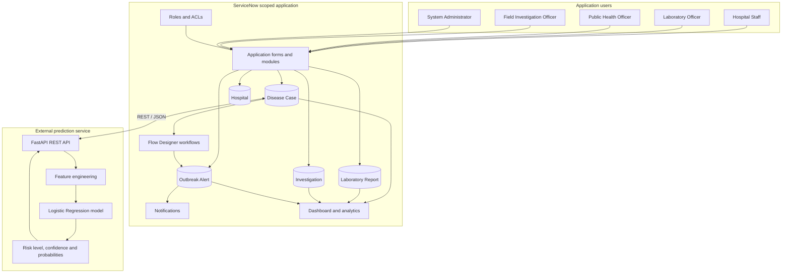
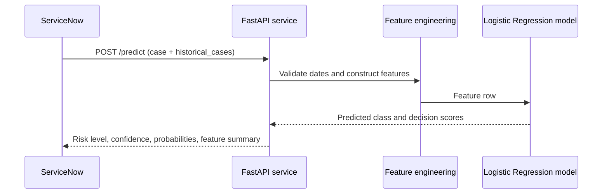

# Solution Design

## 1. Purpose

This document describes the high-level solution design for the AI-Enabled Public Health Disease Surveillance and Outbreak Response Platform. The design combines a ServiceNow scoped application with an external Python prediction API used by US-10.

The diagrams and descriptions represent the implemented project structure at a logical level. Instance-specific configuration names, exact field names, and relationship cardinalities should be taken from the ServiceNow configuration and screenshots when those artifacts are added.

## 2. Architecture overview

The solution has two main parts:

1. **ServiceNow application layer:** stores surveillance records, applies roles and ACLs, runs workflows, sends notifications, and provides dashboards.
2. **External ML service:** accepts current and historical case information through REST/JSON, engineers features, loads a trained Logistic Regression model, and returns a risk estimate.

## 3. ServiceNow application data design

The application contains five custom tables.

| Table | Purpose |
|---|---|
| Disease Case | Stores reported disease case information and case status. |
| Hospital | Stores hospital or reporting-facility information used by the application. |
| Laboratory Report | Stores laboratory test and verification information associated with a disease case. |
| Investigation | Stores field investigation information. |
| Outbreak Alert | Stores detected or recorded outbreak alert information, including disease, location, count, threshold, status, and detection details as configured. |

### 3.1 Logical record associations

- A Laboratory Report is linked to a Disease Case.
- Investigation work is associated with the relevant disease case or surveillance activity according to the configured reference fields.
- Disease Case records contain reporting-facility information associated with the Hospital data used by the application.
- Outbreak Alert records represent a detected disease-location cluster.

Exact ServiceNow reference-field names and cardinalities must be confirmed from the dictionary and form screenshots; they are not inferred here.

## 4. Application roles and access design

The application defines five roles:

- `hospital staff`
- `laboratory officer`
- `public health officer`
- `field investigation officer`
- `system administrator`

Access is controlled through ServiceNow roles and ACLs. The intended and tested role policies recorded for the project include:

- Public Health Officer: read-only case review.
- Field Investigation Officer: create, read, and update investigation records; deletion is restricted.
- System Administrator: full CRUD access to the custom application tables.

Other table-specific operations should be verified against the corresponding ACLs and screenshots before documenting exact permissions.

## 5. Core workflow design

### 5.1 Disease case and laboratory workflow

1. Hospital Staff creates a Disease Case.
2. A Laboratory Officer creates a Laboratory Report associated with that case.
3. Laboratory findings and verification status are recorded.
4. A Public Health Officer reviews the case information according to the configured access policy.

### 5.2 Field investigation workflow

1. An investigation record is created for the relevant surveillance work.
2. The Field Investigation Officer views and updates the investigation information.
3. ServiceNow role and ACL configuration controls the permitted operations.

### 5.3 Outbreak monitoring workflow

The outbreak monitoring logic evaluates matching Disease Case records using disease and location. It checks the configured case-count threshold and creates an Outbreak Alert when the condition is satisfied.

US-07 extends this logic with a reporting-date window and a lookup for an existing alert matching the disease and location. The create step is conditional on the existing-alert lookup returning zero records.

### 5.4 Notifications and dashboard

Configured alert notifications communicate outbreak alert information to the relevant public-health audience. Dashboard components summarize the surveillance information available in the application.

The exact notification recipients, dashboard widget names, and chart configurations should be documented from implementation screenshots rather than assumed.

## 6. US-10 ML integration design

### 6.1 Data flow

### 6.2 API contract

- `GET /health`: returns service status, model filename, and API version.
- `POST /predict`: accepts a current case and a list of historical cases.

The implementation calculates historical disease, location, and disease-location counts; seven-day counts; severity score; and reporting-date attributes. It loads the persisted model from `model/best_outbreak_risk_model.joblib`.

The API response includes:
- `risk_level`
- `confidence`
- `probabilities`
- `feature_summary`

See [US-10 API documentation](../03-Development/US-10_ML_API/README.md).

### 6.3 Model limitation

The supplied API documentation states that the model uses synthetic prototype surveillance data and synthetic analyst-assigned labels. It has not been clinically or epidemiologically validated. The output is an academic prototype estimate and must not be treated as operational public-health advice.

## 7. Security and privacy considerations

- Use role-based access and ACLs for application records.
- Do not commit ServiceNow credentials, tokens, API keys, private instance URLs, or exported authentication data.
- Use synthetic patient information in sample requests and screenshots.
- Review Update Set XML before publishing it.
- Expose the external API only through an appropriately secured HTTPS endpoint when remote integration is required.

## 8. Design decisions and constraints

- ServiceNow is the system of record for the application's surveillance workflows.
- The US-10 prediction service is external to the ServiceNow instance.
- The API expects historical cases to be supplied by its caller; it does not independently query the ServiceNow database.
- The local API requires the persisted model artifact at the configured path.
- US-11 and US-12 are in progress in Jira and are not represented as implemented components; they must remain unmarked as completed until implementation and verification are finished.

## 9. Related documents

- [Business Requirements](../01-Business-Analysis/Business_Requirements_Document.md)
- [Functional Requirements](../01-Business-Analysis/Functional_Requirements.md)
- [Development Overview](../03-Development/Development.md)
